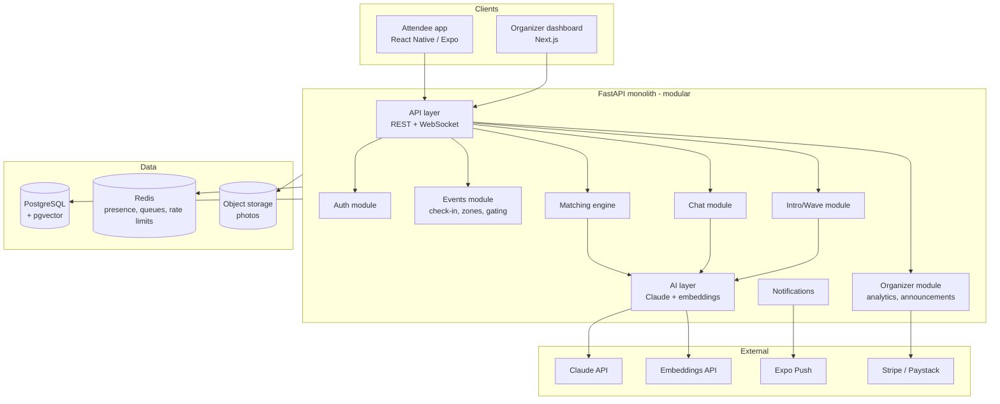

# System Architecture & Technical Design — AiNetwork

**Version:** 0.1 · **Date:** 2026-07-11

## 1. High-level architecture



**Why a modular monolith:** one FastAPI app with clean module boundaries (`app/modules/{auth,events,matching,chat,waves,ai,organizer}`). Microservices at this stage buy nothing but deployment pain. The module boundaries let us split later if one module (chat, matching) needs independent scaling.

## 2. Core data model

```mermaid
erDiagram
    USER ||--o{ EVENT_PROFILE : has
    USER ||--o{ CHECKIN : does
    EVENT ||--o{ EVENT_PROFILE : contains
    EVENT ||--o{ ZONE : has
    EVENT ||--o{ CHECKIN : records
    EVENT_PROFILE ||--o{ GOAL : declares
    EVENT ||--o{ WAVE : hosts
    WAVE }o--|| USER : from
    WAVE }o--|| USER : to
    EVENT ||--o{ CONVERSATION : scopes
    CONVERSATION ||--o{ MESSAGE : contains
    USER ||--o{ CONNECTION : owns
    USER ||--o{ BLOCK : sets
    ORGANIZER ||--o{ EVENT : runs
```

Key tables (abridged):

```sql
users            (id, phone/email, verified_at, real_name, photo_url, home_area_code NULL, created_at)
events           (id, organizer_id, name, venue, starts_at, ends_at, gating ENUM(open, apply), status)
zones            (id, event_id, name, qr_token)
event_profiles   (id, user_id, event_id, display_name, display_photo, headline, offer_text,
                  visibility ENUM(hidden, directory, radar), radar_photo_ok BOOL)
goals            (id, event_profile_id, intent ENUM(hire, get_hired, raise, invest, sell, buy,
                  learn, cofounder, partner, meet), target JSONB, offer TEXT, priority INT,
                  ask_embedding VECTOR(1024), offer_embedding VECTOR(1024))
checkins         (id, user_id, event_id, zone_id NULL, scanned_at)          -- zone rows = session analytics only (never radar)
radar_tokens     (token, user_id, event_id, expires_at)                     -- rotating BLE broadcast IDs, ~5 min TTL
waves            (id, event_id, from_user, to_user, source ENUM(match_feed, radar),
                  card JSONB, status ENUM(pending, accepted, not_now, maybe_later, expired),
                  created_at, resolved_at, resurfaced BOOL DEFAULT false)
conversations    (id, event_id, user_a, user_b, created_from_wave_id, created_at)
messages         (id, conversation_id, sender_id, body, ai_assisted BOOL, created_at)
connections      (id, user_id, peer_id, event_id, met_confirmed_at NULL)    -- tap-to-exchange sets met_confirmed_at
blocks           (id, user_id, blocked_id, created_at)                      -- enforced bidirectionally, permanent
match_scores     (event_id, user_a, user_b, score, components JSONB, computed_at)  -- cache table
reports          (id, reporter_id, subject_id, context JSONB, status, created_at)

-- Office Hours (v2)
office_hour_slots (id, event_id, host_user_id, starts_at, duration_min,
                   price_cents, currency, charity BOOL, status)
bookings          (id, slot_id, attendee_id, paid_at,
                   status ENUM(booked, completed, no_show, refunded))
```

Radar presence lives in Redis: a set of users whose radar screen was active in the last few minutes (`radar_active:{event}`) plus the `radar_tokens` mapping for BLE resolution. Everything expires at event end; Postgres keeps no location history beyond check-in/session timestamps.

## 3. Key flows

### 3.1 Check-in

1. Attendee scans door QR → `POST /events/{id}/checkin {qr_token}`.
2. Gating check: if `apply` mode and no approved application → polite denial.
3. Create `checkins` row, unlock event room, trigger match computation for this user, notify organizer dashboard (WebSocket).

### 3.2 Intro / wave lifecycle (state machine)

```
pending ──accept──▶ accepted ──▶ conversation created, AI seeds icebreakers
   │──not_now──▶ not_now (silent; sender sees "pending" forever)
   │──maybe_later──▶ maybe_later ──next morning, once──▶ pending(resurfaced)
   │──event ends──▶ expired (silent)
```

Rules enforced server-side: one wave per (from, to, event); ~5 waves/hour/user (Redis token bucket); mutual pending waves → auto-accept both + "you noticed each other" notification; `blocks` checked on every read and write.

### 3.3 Matching pipeline (batch + incremental)

1. **Hard filters (SQL):** checked in, visibility ≥ directory, not blocked either way.
2. **Candidate generation (pgvector):** ANN search of my goals' `ask_embedding` against others' `offer_embedding` (and profile embedding). Top ~50.
3. **Two-way scoring:**
   - `fit(A→B)` = max cosine(ask_A, offer_B) blended with intent-complementarity bonus (raise↔invest, hire↔get_hired, sell↔buy) and target-filter matches (role/industry/stage).
   - `goal_score = sqrt(fit(A→B) × fit(B→A))` — geometric mean punishes one-sided matches.
4. **Context boosts:** shared session (+), currently "right here"/at the event together (+), same home city (+, easier follow-up after the event), historical responsiveness (private, never displayed).
5. **Rank + diversity:** top 10 with 1–2 serendipity wildcards. Weights v1: goal 0.7 / context 0.2 / serendipity 0.1.
6. **Explain:** Claude writes "why you two" from the matched components JSON only — grounded, never freestyle.

Runs: full batch at check-in and every 30 min during event; incremental on goal edit. Scores cached in `match_scores`.

### 3.4 Radar

Two layers, no venue hardware, **no GPS, no background location**:

**Layer 1 — event-wide list (base, always works).** `GET /events/{id}/radar` → all checked-in users with radar visibility on. Caller must also be discoverable (reciprocity enforced server-side). Depends on nothing but door check-in.

**Layer 2 — "right here" mode (BLE phone-to-phone).** While the radar screen is open, the phone advertises a rotating anonymous token over Bluetooth and scans for peers doing the same:

- Token = short-lived ID issued by the server (`radar_tokens`, rotates every ~5 min), so an overheard broadcast can't be used to identify or track anyone across time.
- Client reports heard tokens + signal strength to the server; the server resolves tokens to *discoverable* users only and returns **bucket labels**: `right_here` (strong signal, a few steps) / `in_the_area` (weak). Raw signal strength / distance estimates never reach the client UI.
- Foreground-only by design (iOS background BLE restrictions make this the honest choice anyway): radar is an active "I'm open to hellos" mode, not passive tracking. Physical presence is required to hear anyone — radar can never reveal more than the caller's own eyes could.
- Library: `react-native-ble-plx` via a custom Expo dev-client build (BLE is not available in Expo Go).

"Say hi" from either layer creates a `wave(source=radar)` → same card/double-opt-in machinery as match-feed intros. Recipient card shows "also at {event}"; the proximity bucket is revealed only post-accept.

**Zone/session QRs are not part of radar.** They survive only as optional organizer analytics (session attendance) and as the shared-session boost signal for matching.

### 3.5 Chat + wingman

- WebSocket per device (FastAPI native WS; Redis pub/sub for fan-out across instances).
- On conversation create: AI generates 2–3 icebreakers from the matched-signal JSON + both profiles.
- Wingman actions (draft, rewrite-in-tone, suggest-reply) are explicit user actions calling `POST /ai/assist` — the AI never auto-sends.
- Messages flagged `ai_assisted` internally for analytics (never shown to the counterpart).

## 4. AI layer

All Claude calls go through one module (`app/modules/ai/`) with a single client, prompt registry, and per-user rate limits.

| Task | Model | Technique |
|---|---|---|
| Parse free-text/voice goals → structured goal | `claude-opus-4-8` | Structured outputs (`client.messages.parse` with Pydantic schema) — guaranteed valid JSON |
| Draft intro card ("why you two" + opener) | `claude-opus-4-8` | Grounded prompt: matched-components JSON + both profiles; instructed to cite only provided signals |
| Icebreakers + reply suggestions + tone rewrite | `claude-opus-4-8` | Short prompts; prompt-cache the stable system prompt |
| Batch match explanations (pre-compute overnight) | `claude-opus-4-8` via **Batches API** | 50% cost reduction for non-latency-sensitive generation |
| Content safety screen on intro cards | `claude-opus-4-8`, `effort: low` | Cheap classification pass before card is deliverable |

Example — goal parsing:

```python
from pydantic import BaseModel
from typing import Literal
import anthropic

class GoalTarget(BaseModel):
    roles: list[str]
    industries: list[str]
    company_stage: list[str]

class Goal(BaseModel):
    intent: Literal["hire","get_hired","raise","invest","sell","buy",
                    "learn","cofounder","partner","meet"]
    target: GoalTarget
    offer: str
    priority: int

client = anthropic.Anthropic()

def parse_goal(free_text: str) -> Goal:
    resp = client.messages.parse(
        model="claude-opus-4-8",
        max_tokens=1024,
        system=GOAL_PARSER_SYSTEM,          # stable → prompt-cached
        messages=[{"role": "user", "content": free_text}],
        output_format=Goal,
    )
    return resp.parsed_output
```

**Embeddings:** Anthropic doesn't provide embeddings — use Voyage AI (or another provider) for ask/offer texts; store in `pgvector`, one embed per goal per event. Cost is negligible at event scale.

**Prompt caching:** system prompts are frozen strings (no timestamps/user IDs interpolated); volatile content goes in the user turn — this keeps cache hits high across the event's thousands of small calls.

**Feedback loop (the moat):** every wave outcome, chat-that-converted, and confirmed meeting is a labeled example → periodic re-tuning of scoring weights (start with a simple logistic regression over score components; no fancy ML until data justifies it).

## 5. Realtime & notifications

| Channel | Use |
|---|---|
| WebSocket (FastAPI + Redis pub/sub) | Chat messages, wave status changes, organizer live-attendance |
| Expo Push | Intro cards received, mutual match, meet reminders, announcements, morning-after summary |
| Redis token buckets | Wave rate limits, AI-assist rate limits |

## 6. Security & privacy invariants (enforced in code review)

1. No endpoint ever returns another user's distance, direction, or location pre-acceptance — proximity is exposed only as bucket labels (`right_here` / `in_the_area`), and only to mutually discoverable users.
2. Raw BLE signal strength stays server-side; radar tokens rotate (~5 min) and all presence data expires at event end. Stored location history = check-in/session timestamps only.
3. `blocks` is joined into **every** people-returning query (directory, radar, matching, chat).
4. First-contact payloads are server-constructed cards — client cannot inject free text into a wave.
5. Home area is a picker code, never geocoded input; visible only via `connections`.
6. All AI drafts pass the safety screen before delivery.
7. PII minimal; messages encrypted at rest; export/delete endpoints from day one.
8. Money never touches ranking: neither premium status nor Office Hours listings can influence match scores, feed order, or wave queues. Office Hours is a separate surface.

## 7. Deployment (v1)

- **API:** Docker on Railway/Fly/Render (single region near first event), 2+ instances behind LB, WS sticky via Redis pub/sub.
- **DB:** managed Postgres with pgvector (Neon/Supabase/RDS).
- **Redis:** Upstash/managed.
- **Storage:** S3-compatible (photos), CDN in front.
- **Observability:** structured logs + Sentry; a "mission control" dashboard for event day (check-in rate, error rate, AI latency).
- **Event-day failure mode:** if AI layer is down, matching serves cached scores and chat works without wingman — the app degrades to a functional event app, never to a brick.
