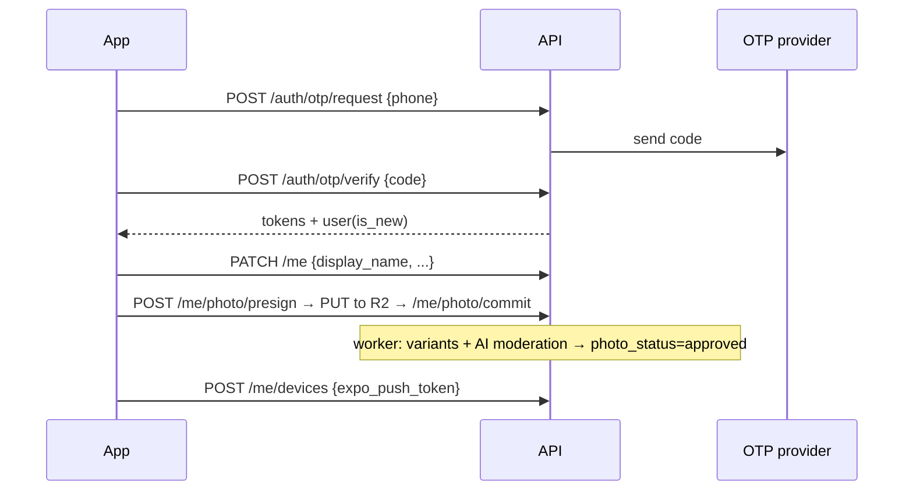
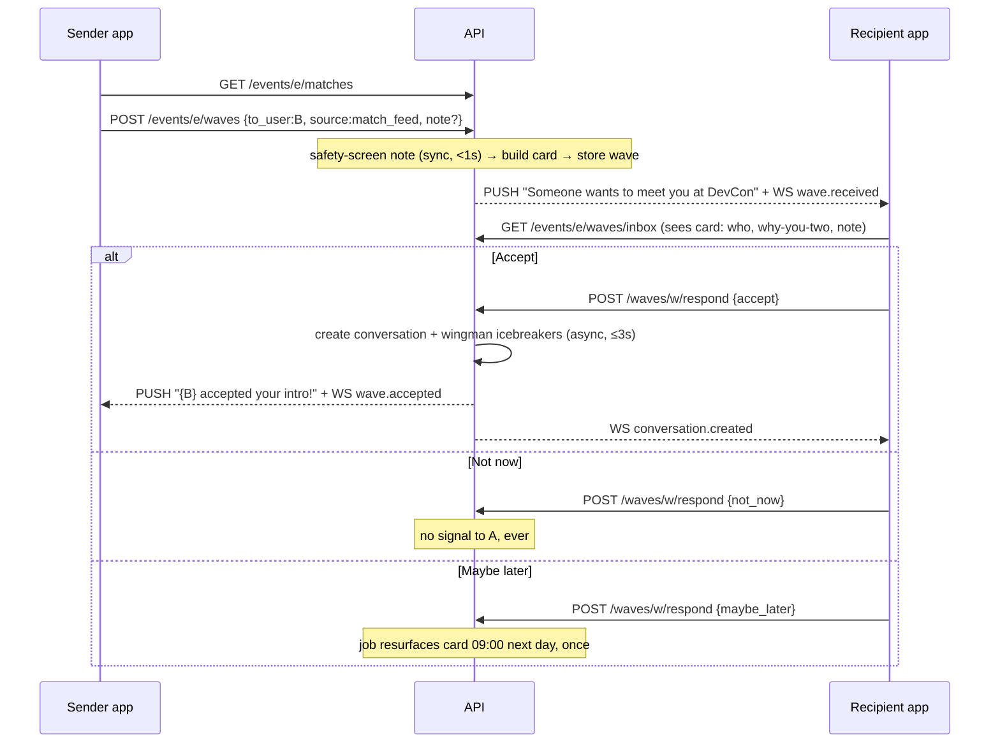

# 04 — Core Flows (sequence level)

Numbered steps + failure branches. WS = WebSocket event (see 07), PUSH = Expo push.

## 1. Signup → event-ready

Failure branches: OTP undeliverable → switch channel; photo rejected → push "photo couldn't be approved", placeholder stays.

## 2. Register → check in → event room

1. `POST /events/{id}/apply` → approved (open) or pending (apply → organizer decides → PUSH).
2. At the door: scan rotating QR → `POST /checkin`.
3. On success: server (a) writes check-in, (b) enqueues `matching.compute_for_user(event,user)`, (c) WS `event.checkin_count` to organizer dashboard, (d) client navigates to Event Room.
4. Event Room bootstrap: `GET /events/{id}/room`. If no event profile yet → event-card sheet (display name/photo prefilled; user picks visibility; writes offer_text).
5. Goals: user types free text → `POST /goals/parse` → editable form → `POST /goals` → worker embeds → matching refresh.

Failure branches: stale QR (screenshot) → `qr_stale`, staff directs to live screen; apply-gated without approval → `checkin_not_approved` + apply CTA.

## 3. Match feed → wave → accept → chat

Mutual-wave branch: on wave create, server checks reverse pending wave; if found → both `accepted`, conversation created, both PUSH "You noticed each other 🎉".

## 4. Chat with wingman → meet → tap-to-exchange

1. Conversation opens with a `kind='icebreakers'` block (visible to both).
2. Typing: user may call `POST /ai/assist` (draft/rewrite/suggest) → inserts editable text → `POST /messages` (WS fan-out to peer, PUSH if offline).
3. Meet: `POST /conversations/{id}/meet {point, time}` → `meet_proposal` message → peer accepts → both get reminder PUSH at T−10 min.
4. In person: A `POST /exchange/token` → shows QR; B scans → `POST /exchange/scan` → both apps show "Confirm you met?"; both `POST /exchange/{cid}/confirm` → connections written (with each side's consented contact fields), WS `connection.confirmed`, organizer meeting counter +1.
5. Timeout: confirm_id TTL 10 min; single-sided confirm → no connection (retry anytime).

## 5. Radar session (v1.5)

1. User opens Radar tab → if visibility ≠ radar → explainer + one-tap upgrade (photo check).
2. `GET /radar` renders Layer-1 list. In parallel: `POST /radar/token` → start BLE advertise (token in manufacturer data) + scan.
3. Every 10 s: batch heard `{token,rssi}` → `POST /radar/sightings` → response `{user_id: bucket}` → list reorders, "right here" chips appear.
4. `Say hi` → wave flow (§3) with `source='radar'`; recipient card omits proximity ("also at DevCon").
5. Close tab → stop advertise/scan ≤ 30 s; tokens expire ≤ 5 min; Layer-1 presence unaffected.
6. Ghost tap → `POST /radar/ghost` → removed from list + broadcast stops + browse disabled.

## 6. Wave expiry & maybe-later resurface (workers)

- `waves.expire` (every 15 min): `pending|maybe_later` waves of events past `ends_at+24h` → `expired`. No notifications.
- `waves.resurface` (hourly): `maybe_later AND NOT resurfaced AND recipient-local time in [09:00,10:00)` → PUSH + inbox re-pin, set `resurfaced=true`.

## 7. Matching batch (workers) — details in 05

- `matching.compute_for_user`: triggered by check-in/goal-edit. Candidate gen → scoring → upsert `match_scores` → generate explanations for NEW top-10 pairs (Claude, batched) → WS `matches.updated`.
- `matching.recompute_event` (every 30 min while live): incremental for users with stale scores.
- `matching.nightly_weights` [post-pilot]: retrain component weights from `match_feedback` (logistic regression); write to `settings` table; A/B guarded.

## 8. Morning-after summary (v1.5)

`postevent.summary` job at 09:00 local day after `ends_at`: for each checked-in user → aggregate (connections made, meetings confirmed, open conversations) → Claude drafts ≤ 2 follow-up messages (batch API) → PUSH "Your DevCon wrap-up is ready" → in-app summary screen with approve-to-send drafts.

## 9. Office Hours booking (v2)

1. VIP creates slots → listed in Office Hours tab.
2. Attendee books → payment init (Paystack/Stripe checkout) → webhook confirms → `bookings.booked`, both notified + reminders.
3. At slot: tap-to-exchange (§4.4) marks `completed` → payout queued (T+2 days, minus fee).
4. No confirmation by slot_end + 30 min → attendee prompted; dispute → moderation queue; VIP no-show → auto-refund + strike.

## 10. Organizer live day

1. Door staff opens door-screen page (rotating QR, fullscreen).
2. Dashboard subscribes WS `event:{id}:stats` → live counter.
3. Announcement: compose → confirm → PUSH to all checked-in devices + in-app banner (WS).
4. Post-event: `stats/report` available when `status='ended'` (set by job at `ends_at`, organizer can end early).
